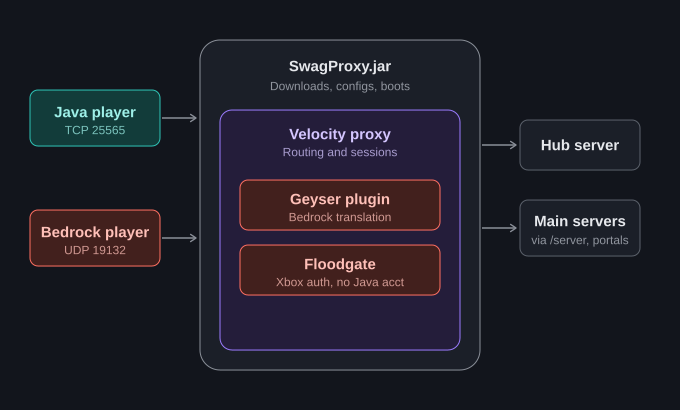

# Architecture Overview

SwagProxy is a **standalone Java 21 application** (`com.swag.swagproxy.Main`) — not a Bukkit plugin, not a Velocity plugin, and not a new proxy implementation. It contains no Minecraft protocol code at all. Its entire job is to download, configure, launch, and supervise a real Velocity process running the real Geyser and Floodgate plugins.



## Why one proxy

Players connect to SwagProxy — Java over TCP (`java-port`), Bedrock over UDP (`bedrock-port`) — and stay connected to it for their entire session. Moving between backend servers (via your own hub/lobby plugin) just repoints the existing connection through Velocity's native `Connect` plugin-message channel; SwagProxy needs no code for that hop. **Never chain SwagProxy behind or in front of another proxy** — there is exactly one proxy in this architecture.

## Package layout

```
com.swag.swagproxy
  Main, Layout, Bootstrapper, BootstrapException     - entry point, path layout, startup orchestration
  config/          - swagproxy.yml model + loader/validator (ConfigManager, SwagProxyConfig, ...)
  download/        - GeyserApiClient, VelocityApiClient, UpdateManager (stage/apply/rollback), BuildTracker
  process/         - ProxySupervisor (launch/passthrough/crash-relaunch), ConsoleRouter (manual commands)
  schedule/        - RestartScheduler (timezone-aware fire-time math, warnings)
  velocity/        - VelocityTomlWriter, GeyserConfigManager (config generation/patching)
  util/            - Log (rotating file+console), Sha256, DurationParser, HttpUtil
```

## Startup sequence (`Bootstrapper.run()`)

1. Configure `HttpUtil` with the `updates.contact` value (logs a reminder if it's still the placeholder).
2. Load `data/builds.json` into a `BuildTracker` and construct the `UpdateManager`.
3. Ensure Velocity, Geyser, and Floodgate are installed — downloading the latest build of any that's missing. Failure here is fatal, since the proxy can't start without them.
4. Run an immediate `checkAndStageAll()` update check.
5. Write `proxy/velocity.toml` from the current config (`VelocityTomlWriter`).
6. Generate `proxy/forwarding.secret` if it doesn't already exist (32 random bytes, base64url-encoded).
7. Generate/patch Geyser's `config.yml` (`GeyserConfigManager`).
8. Construct the `ProxySupervisor` and call `launchInitial()` — this is the first real Velocity boot.
9. Start the `RestartScheduler` (timezone-aware scheduled restarts).
10. Start the `ConsoleRouter` on a daemon thread, reading SwagProxy's own stdin.
11. Register a JVM shutdown hook that gracefully shuts down Velocity and the scheduler on Ctrl+C / process termination.

## Login flow (for reference)

1. Everyone connects to SwagProxy first — Java via TCP `java-port`, Bedrock via UDP `bedrock-port`.
2. Bedrock: Geyser translates the session continuously (not just at login); Floodgate authenticates via Xbox (`.`-prefixed username, no Java account needed). Java clients pass straight through — Geyser never touches them.
3. Both land on the `try-order[0]` backend (typically your hub server).
4. The hub's `bungeecord:main` `Connect` plugin messages come back to this same Velocity instance, which repoints the player at the target backend. Velocity answers that channel natively.

See [Login Flow](../backend/login-flow.md) for the full walkthrough and [Backend Migration Checklist](../backend/migration.md) for the exact backend-side settings this requires.

## What SwagProxy explicitly does not do

- It does not implement any Minecraft protocol logic itself — that's entirely Velocity/Geyser/Floodgate's job.
- It does not hot-swap jars into a running Velocity process — updates are staged and only applied at a restart.
- It does not support any forwarding mode other than Velocity's modern forwarding.
- It does not provide a built-in broadcast/chat command for warning messages — see [Restart Schedule & Warnings](../operations/restart-schedule.md).

## Next steps

- [Update, Staging & Rollback](updates-and-rollback.md)
- [Fresh-Install Candidate Probing](candidate-probing.md)
- [Console Commands](../operations/console-commands.md)
